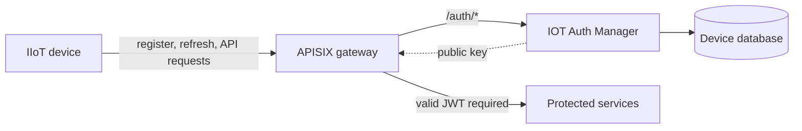
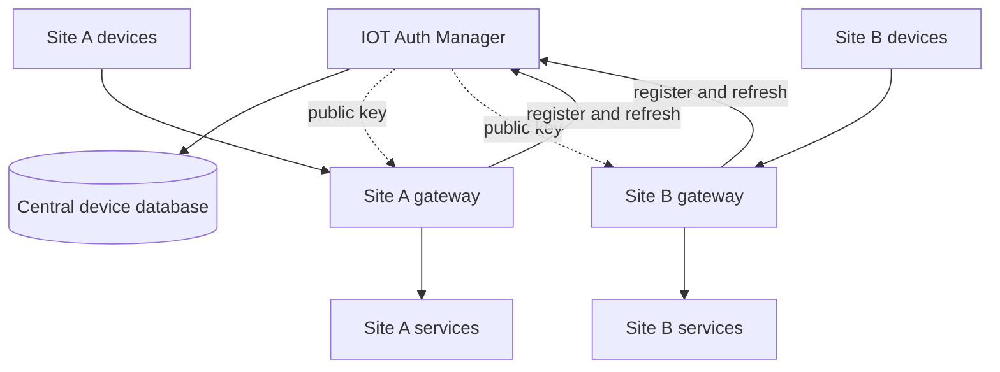

# Deployment

IOT Auth Manager can provide device authentication for one industrial site or for services spread across several sites. It issues short-lived RS256 JSON Web Tokens (JWTs). APISIX or an application verifies each token with the public key before allowing a request to reach a protected service.

The private key stays with IOT Auth Manager. Gateways and protected applications receive only the public key.

## Single-site deployment

A single-site deployment is the simplest arrangement and should be the starting point for most installations.

APISIX is the device-facing entry point. It sends registration and token refresh requests to IOT Auth Manager, and sends authenticated requests to protected services. IOT Auth Manager keeps the device record and hashed device secret in PostgreSQL and uses its private key to sign access tokens.

For production, keep the service and database on a server or control network. Do not expose port 3000 or PostgreSQL directly to the device network. Expose only the required APISIX routes over TLS.

## Multi-site deployment

There are two practical models.

### Central authentication service

Run one IOT Auth Manager and database for all sites. Each site gateway trusts the same public key.

This gives one device inventory and one signing authority. It is easier to operate, but registration and token refresh depend on connectivity to the central site. A device with an unexpired token can continue to use a local protected service while the central service is unavailable.

### Authentication service at each site

Run an IOT Auth Manager and database at each site. A device registers and refreshes through its home site because its secret is stored in that site's database.

This model keeps local authentication available during a WAN outage. For a token to work at another site, that site's gateway must trust the issuing site's public key and use compatible JWT settings. Each issuer should have its own key pair and gateway trust entry.

The project does not currently synchronize device records, secrets, or site configuration. Cross-site trust and database replication must be designed and operated separately. Copying one private key to every site reduces configuration work, but increases the impact of a key compromise and is not recommended.

## What the current service supports

- Registers device inventory and can create an authentication secret for a device.
- Exchanges a valid device UUID and secret for a short-lived RS256 access token.
- Publishes the signing public key as JWKS.
- Lets APISIX validate tokens at the gateway, or the supplied Express middleware verify signature, issuer, audience, and expiry.
- Keeps authentication secrets as hashes rather than returning them from read APIs.
- Records the most recent successful token refresh.

## Current limits

- A valid token proves device identity; it does not provide roles, scopes, or per-route authorization.
- Disabling a device or changing its database record does not revoke a token already issued. The token remains valid until it expires.
- There is no built-in multi-site database synchronization, device migration, or global management plane.
- Key rotation and distribution are not automated. Gateways and applications must be updated when keys change.
- The supplied deployment is a single service instance. High availability, database failover, backups, and disaster recovery are operator responsibilities.
- TLS certificates and production network controls are not configured by the project.
- The service has no operator UI or complete administrative API for device lifecycle management.

## Production controls

Before connecting production equipment:

1. Terminate TLS at APISIX and allow device traffic only to required gateway routes.
2. Keep the APISIX Admin API, IOT Auth Manager, PostgreSQL, and private key off the device network.
3. Mount the private key read-only and store its backup under the site's normal secrets controls.
4. Use a registration code during commissioning and do not leave registration open to an untrusted network.
5. Keep issuer and audience values consistent between each token issuer and its verifiers. When using the supplied APISIX scripts, `SERVICE_KEY` must match the token issuer value.
6. Back up PostgreSQL and test recovery. Losing the database prevents devices from refreshing their tokens.
7. Monitor failed registrations, failed refreshes, HTTP 401 responses, service health, and database capacity.
8. Keep gateway, service, database, and device clocks synchronized. Token expiry depends on accurate time.

For a first industrial deployment, use the single-site model or a central authentication service. Choose site-local authentication only where WAN independence is required and the extra key, trust, and database operations are understood.
